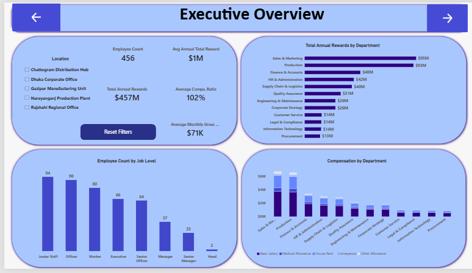
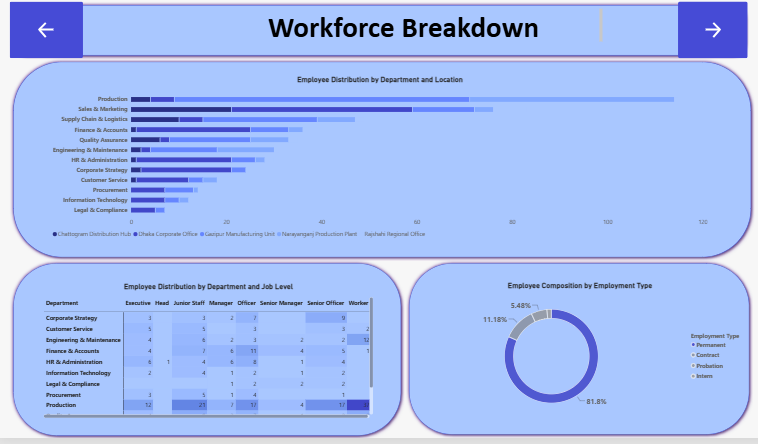
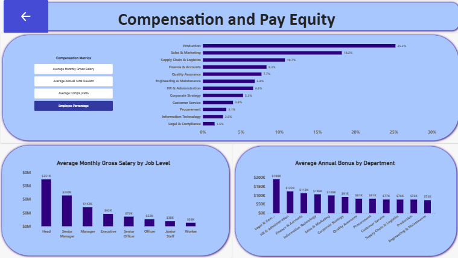
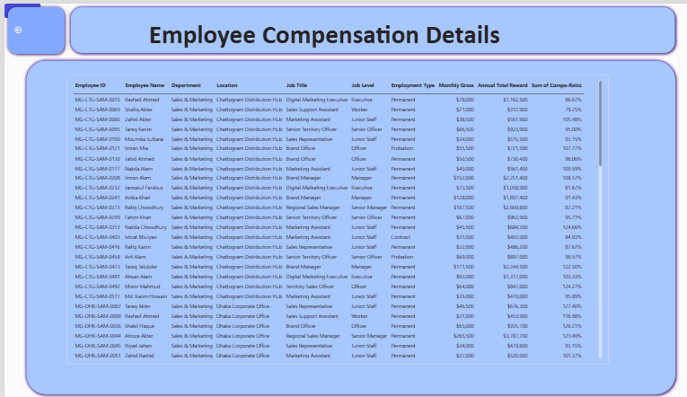

\# HR Compensation \& Workforce Analytics Dashboard

\## Project Overview

This project presents an interactive HR Compensation and Workforce Analytics Dashboard developed using Microsoft Power BI.

The dashboard analyses employee distribution, compensation structures and pay positioning across departments, locations and job levels.

It provides an interactive way to explore workforce composition, compare compensation across organizational groups and examine differences in salary and annual rewards.

The project demonstrates practical application of Power Query, DAX, data visualization and Power BI interactive features to transform employee compensation data into meaningful business insights.

\## Project Objectives

The dashboard was developed to answer the following business questions:

\- How is the workforce distributed across departments, locations and job levels?

\- What is the workforce composition by employment type?

\- How does total annual reward expenditure vary across departments?

\- How do average monthly gross salaries and annual bonuses differ across departments?

\- How does compensation positioning vary across departments?

\- What compensation information is available at individual employee level?

\## Dataset

The project uses the \*\*Mokhles Group HR Analytics Portfolio BD FY2025\*\* dataset, downloaded from Kaggle.

\*\*Dataset source:\*\* \[Mokhles Group HR Analytics Portfolio BD FY2025](https://www.kaggle.com/datasets/samusahr/mokhles-group-hr-analytics-portfolio-bd-fy2025)

The dataset contains 456 employee records and includes information such as:

\- Employee details

\- Department and location

\- Job title and job level

\- Employment type

\- Basic salary and allowances

\- Monthly gross compensation

\- Annual bonus

\- Employer contributions and benefits

\- Annual total reward

\- Compa-ratio

All monetary values are expressed in \*\*United States Dollars (USD)\*\*.

\## Tools and Technologies

\- \*\*Microsoft Power BI Desktop:\*\* Dashboard development and data visualisation.

\- \*\*Power Query:\*\* Data preparation and data type transformation.

\- \*\*DAX:\*\* Analytical calculations and measures.

\- \*\*GitHub:\*\* Project documentation and portfolio presentation.

\## Data Preparation

Data preparation was performed using Power Query.

The main preparation activity involved reviewing the dataset and assigning appropriate data types to the columns.

Analytical calculations were handled using DAX measures.

\## DAX Measures

The following measures were created to support the analysis:

| Measure | Purpose |
|---|---|
| Employee Headcount | Calculates the distinct number of employees. |
| Total Annual Rewards | Calculates total annual employee rewards. |
| Average Monthly Gross Salary | Calculates average monthly gross compensation. |
| Average Annual Total Reward | Calculates average annual total reward per employee. |
| Average Compa-Ratio | Calculates the average compa-ratio. |
| Average Annual Bonus | Calculates the average annual bonus. |
| Employee Percentage | Calculates each department's share of the workforce. |

\## Dashboard Structure

The report contains five pages:

\### 1. Contents

Provides navigation to the three main analytical sections of the report.

\### 2. Executive Overview

Presents a high-level summary of the workforce and compensation structure through KPI cards and charts.

Key metrics include:

\- Employee headcount

\- Total annual rewards

\- Average monthly gross salary

\- Average annual total reward

\- Average compa-ratio

The page also explores annual rewards by department, employee distribution by job level and monthly gross compensation composition by department.

\### 3. Department \& Workforce Analysis

Examines workforce distribution across departments, locations and job levels.

Visualizations include:

\- Workforce distribution by department and location.

\- Workforce composition by employment type.

\- Employee headcount by department and job level using a matrix with conditional formatting.

\### 4. Compensation \& Pay Equity

Provides a more detailed comparison of compensation across departments and job levels.

The page includes:

\- A dynamic field parameter chart that switches between average monthly gross salary, average annual total reward, average compa-ratio and employee percentage of total workforce.

\- Average monthly gross salary by job level.

\- Average annual bonus by department.

\### 5. Employee Details

A drill-through page that provides employee-level information, including employee ID, employee name, department, location, job title, job level, employment type and compensation details.

\## Interactive Power BI Features

The dashboard incorporates the following interactive features:

\- \*\*Field Parameters:\*\* Allow users to switch between different analytical metrics within the same chart.

\- \*\*Slicers:\*\* Enable filtering by location across analytical pages.

\- \*\*Drill-down:\*\* Allows users to move from department-level analysis to job-level analysis.

\- \*\*Drill-through:\*\* Enables navigation from departmental analysis to individual employee details.

\- \*\*Bookmarks:\*\* Support report navigation and resetting filters.

\- \*\*Conditional Formatting:\*\* Highlights differences in workforce distribution within the matrix.

\- \*\*Cross-filtering and Cross-highlighting:\*\* Allow users to explore relationships between visualizations.

\## Key Findings and Insights

\### Workforce Distribution

\- The organization has 456 employees across 12 departments.

\- Production has the largest workforce, with 115 employees (25.2%).

\- Sales \& Marketing follows with 83 employees (18.2%).

\- Supply Chain \& Logistics has 49 employees (10.7%).

\- The three largest departments account for approximately 54.2% of the workforce.

\- Legal \& Compliance has the smallest workforce, with 7 employees.

\### Employment Composition

\- Permanent employees account for approximately 81.8% of the workforce.

\- Contract employees account for 11.1%.

\- Employees on probation account for 5.4%.

\- Interns account for 1.8%.

\### Compensation Analysis

\- Total annual rewards amount to approximately \*\*$457 million\*\*.

\- Sales \& Marketing and Production account for the largest departmental reward totals, at approximately $95 million and $93 million respectively.

\- Legal \& Compliance records the highest average monthly gross salary, at approximately $144,429.

\- Production records the lowest average monthly gross salary, at approximately $56,643.

\### Pay Positioning

Average compa-ratios vary across departments:

\- Corporate Strategy records the highest average compa-ratio, at approximately 115%.

\- Legal \& Compliance follows at approximately 114%.

\- Production records the lowest average, at approximately 95%.

For this analysis, compa-ratio is interpreted as employee compensation relative to the salary range midpoint:

\- Above 100% indicates compensation above the midpoint.

\- 100% indicates compensation at the midpoint.

\- Below 100% indicates compensation below the midpoint.

\## Dashboard Screenshots

Screenshots of the completed Power BI dashboard are displayed below.

\### Executive Overview

\### Department \& Workforce Analysis

\### Compensation \& Pay Equity

\### Employee Details

\## Conclusion

This project demonstrates how Power BI can be used to analyze HR and compensation data through interactive dashboards, DAX calculations and data visualization.

It provides insights into workforce distribution, compensation structures and departmental pay positioning while allowing users to explore the data at different organizational levels.

